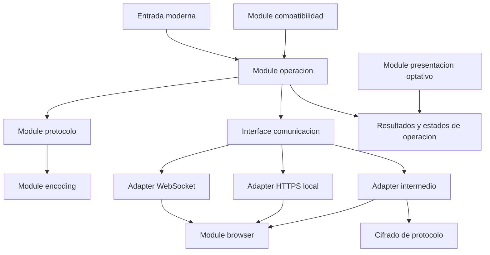

# Estudio de refactor de AutoScript a TypeScript

Fecha: 2026-10-14.

Estado: estudio completo de las fuentes disponibles. Implementacion no iniciada.

## Resumen ejecutivo

La recomendacion es una migracion incremental con un nucleo tipado, codecs de
protocolo verificables, comunicacion separada por transporte y compatibilidad
legacy optativa. El objetivo no es repartir 6.181 lineas entre archivos: es
concentrar las decisiones, eliminar estado compartido accidental, reducir
conversiones y hacer comprobable cada contrato con Autofirma.

Conclusiones que condicionan todo el proyecto:

1. AutoScript es un puente hacia Autofirma, no un motor de firma en JavaScript.
   No se deben implementar CAdES, XAdES, PAdES, FacturaE, almacenes de claves ni
   gestores Java de documentos dentro de esta libreria.
2. Existen tres transportes reales: WebSocket local, HTTPS local y servidor
   intermedio. Este ultimo sigue siendo necesario en movil y en el modo forzado.
3. La Interface publica tiene diferencias que una reescritura superficial
   perderia: `coSign` y `cosign` no tienen la misma aridad; `signBatchProcess`
   no recibe directamente un JSON; `echo` no verifica que Autofirma este abierta.
4. Se han reproducido defectos locales, no solo detectado estilo antiguo:
   exports WebSocket, timeout HTTPS, lote XML intermedio, escape XML, nombre de
   aplicacion y conversiones Base64/UTF-8.
5. Hay criptografia condicionada por protocolo. La ruta DES usa ECB en esta
   Implementacion, aunque sus comentarios digan CBC. No se puede sustituir por
   AES-GCM, cambiar padding o retirar DES sin comprobar al interlocutor nativo.
6. La firma nativa es secuencial. Las oportunidades de escalado son el tratamiento
   eficiente de datos, los lotes y referencias de documentos en servidor; no
   ejecutar `Promise.all` sobre firmas del mismo cliente.
7. Se propone usar TypeScript moderno, APIs web nativas y pocas dependencias
   justificadas. Ninguna dependencia nueva se ha instalado en esta fase.

El 100 % se refiere a cobertura del estudio de las dos fuentes: no a ausencia
garantizada de todos los bugs ni a certificacion de la futura libreria. Las
pruebas con Autofirma real, certificados, servidores y dispositivos siguen siendo
puertas obligatorias de la implementacion.

## 1. Alcance, metodo y trazabilidad

### 1.1 Fuentes y versiones

| Fuente | Identificacion | Cobertura |
| --- | --- | --- |
| [autoscript.js](autoscript.js) | AutoScript `1.10.1`, `VERSION_CODE = 4`, 6.181 lineas | Lectura completa, inventario y probes locales |
| [MCF-manual-integrador-ES.md](MCF-manual-integrador-ES.md) | Manual de Autofirma `1.9`, 7.130 lineas | Lectura completa, capitulos 1-10 y anexos I-II |
| [../package.json](../package.json) | Paquete `autoscript-ts`, version `0.0.0`, privado | Requisitos de empaquetado y herramientas actuales |
| [../tsconfig.json](../tsconfig.json) | ES2022, NodeNext, strict, isolatedDeclarations | Restricciones de tipos y emision |
| [../README.md](../README.md) | Plantilla, no migracion funcional | Punto de partida del proyecto |

La version del JavaScript no identifica necesariamente la version instalada de
Autofirma. Ni el manual 1.9 ni el numero `1.10.1` del script bastan para fijar una
matriz de compatibilidad nativa.

Hashes SHA-256 de las referencias, tomados antes del estudio:

```text
autoscript.js
649ACE348A9E4478436ED0FAB32922B401E31F3EF6461949882A9BD95C8BE5EC

MCF-manual-integrador-ES.md
23BF1FAA4ECF7E613AB6FF850E98CEE474A1A2E5AC83A4C3E0634E28D0E51C00
```

### 1.2 Nivel de evidencia

- **R**: reproducido en Node con funciones puras o mocks, sin red, sin DOM real
  y sin ejecutar Autofirma. Confirma ese comportamiento local, no el sistema entero.
- **E**: evidencia directa en codigo o manual. El efecto final puede depender
  del navegador, la respuesta nativa o el uso del integrador.
- **H**: hipotesis que requiere una prueba discriminante antes de corregir.
- **D**: decision propuesta de producto/arquitectura; requiere aprobacion.

Los probes que necesitaron acceso a funciones cerradas insertaron hooks solo en
una copia del texto en memoria. No se han agregado exports ni modificado las
fuentes. Se contrastaron firmas publicas, Base64, ramas de construccion de
peticiones y un vector DES conocido. No se firmaron documentos, no se abrieron
puertos ni se solicitaron claves, contrasenas o PIN.

### 1.3 Fuera de esta fase

No se cambia codigo de `src`, configuracion de build, dependencias, lockfile,
servidores Java, licencia del paquete ni politica de navegadores. Las tablas de
destino y las fases siguientes son propuestas, no trabajo ya realizado.

## 2. Hallazgos y prioridades

P0 significa bloqueante para una futura distribucion segura; P1, defecto o riesgo
que debe resolverse antes de declarar paridad; P2, mejora de mantenibilidad o
recorte condicionado. La prioridad no atribuye una vulnerabilidad explotable
cuando no se ha probado un escenario de ataque.

### 2.1 Hallazgos confirmados

| ID | Prioridad / evidencia | Hallazgo y anclaje | Consecuencia y siguiente comprobacion |
| --- | --- | --- | --- |
| H01 | P0 / E | `console.log("URL: " + url)` en la subida intermedia [autoscript.js](autoscript.js#L4870) | La URI puede contener `key`, `cipher`, identificadores y configuracion. Redactar trazas; comprobar todas las rutas de log y que no aparece ningun secreto de transporte. |
| H02 | P0 / R+E | DES decimal y fallback LCG [autoscript.js](autoscript.js#L4678) | Una clave de ocho digitos tiene como maximo $10^8$ posibilidades. El modo probado es ECB; el fallback no es un CSPRNG. Aislar compatibilidad y decidir politica segura antes de distribuir. |
| H03 | P1 / R | Export WebSocket duplicado [autoscript.js](autoscript.js#L2980) | `getErrorType` termina apuntando a `getErrorCode`; no existe el export `getErrorCode`. El getter publico puede fallar y el tipo se sustituye por el codigo. Probe confirmado; convertirlo en regresion. |
| H04 | P1 / R | `createKeyValuePair` fuera de alcance en HTTPS [autoscript.js](autoscript.js#L3340) | Con `serviceTimeout` configurado, la construccion de firma produce `ReferenceError`. Revisar tambien `generateDataToSignAndSave`; probar todos los transportes con timeout 0 y positivo. |
| H05 | P1 / R | `dataB64` no declarado en lote XML intermedio [autoscript.js](autoscript.js#L4468) | La rama falla antes de transmitir. El dato local disponible es `batchB64`; caracterizar y corregir en su Module antes de la paridad. |
| H06 | P1 / R | `buildXML` concatena atributos sin escape [autoscript.js](autoscript.js#L5029) | Valores con comillas, `&` o `<` generan XML incorrecto y pueden cambiar su estructura. Usar serializacion XML con escape y limites; comprobar round-trip de atributos. |
| H07 | P1 / E | Cadena `generateKey` / `exportKey` sin `catch` [autoscript.js](autoscript.js#L4743) | Un rechazo no llega al callback de error. Las capturas posteriores de cifrado/descifrado no cubren esta fase. Probar rechazos en cada paso y terminacion unica. |
| H08 | P1 / R | UTF-8 manual sin pares sustitutos [autoscript.js](autoscript.js#L5862) | U+1F600 produce `7aC97biA` en lugar de `8J+YgA==`. El helper no cumple UTF-8 estandar para caracteres astrales. Sustituir por bytes UTF-8 y explicitar la ruptura del comportamiento incorrecto. |
| H09 | P1 / R | Normalizacion CRLF implicita [autoscript.js](autoscript.js#L5863) | `a\r\nb` se codifica como `a\nb`. Puede cambiar los bytes que se firman. El codec nuevo no debe normalizar texto silenciosamente; caracterizar compatibilidad. |
| H10 | P1 / R | URL-safe parcial en ArrayBuffer [autoscript.js](autoscript.js#L5778) | `.replace('+', '-').replace('/', '_')` cambia solo una ocurrencia. Se reprodujo `_///////` con seis bytes `0xff`. Unificar codecs standard/url-safe. |
| H11 | P1 / R+E | Condicion invertida de `appname` [autoscript.js](autoscript.js#L2274) | Tras `setAppName`, el builder WebSocket envia el dominio. Se repite en builders HTTPS; servidor intermedio usa otra condicion. Resolver una sola regla y evitar doble percent-encoding. |
| H12 | P1 / E | Objeto `dlgload` sin propiedad `value` [autoscript.js](autoscript.js#L4799) | Se crea `{key: "dlgload", showDialog}`; `buildUrl` busca `value` y omite la opcion. Probar `enableProgressDialog(false)` en los tres transportes. |
| H13 | P1 / E | Callbacks globales de descarga [autoscript.js](autoscript.js#L441) | Dos descargas pueden sobrescribir callback y modo de datos. El estado debe pertenecer a cada peticion; reproducir respuestas en orden inverso. |
| H14 | P1 / E | Descarga con HTTP no-200 sin terminacion [autoscript.js](autoscript.js#L470) | `onload` solo procesa 200 y no notifica 404/500; error de HTTP no equivale a evento `onerror`. Probar red, HTTP, respuesta vacia y abort. |
| H15 | P1 / E | Operacion y callbacks mutables por cliente [autoscript.js](autoscript.js#L2398) | El propio comentario dice que se conserva la ultima URL. Llamadas solapadas pueden desplazar una operacion. Rechazar busy o encolar de forma controlada; conservar serializacion nativa. |
| H16 | P1 / E | Helpers de transporte compartidos fuera de los clientes [autoscript.js](autoscript.js#L291) | `execAppIntent`, `waitAppAndProcessRequest` y `sendEcho` se reasignan desde distintos constructores. Cargar de nuevo o cambiar transporte mezcla closures. Estado y helpers deben pertenecer al Adapter. |
| H17 | P1 / E | Acceso a socket despues de constructor fallido [autoscript.js](autoscript.js#L2519) | Tras el `catch`, se asigna `webSocket.onopen` aunque puede no haber socket. Necesita salida de error unica y limpieza de candidatos. |
| H18 | P1 / E | Globales implicitos y sintaxis incompatible con strict [autoscript.js](autoscript.js#L1004) | `delete element` impide analizar el script bajo strict. Hay asignaciones sin declaracion en respuestas/fragmentos. No basta cambiar extension a `.ts`; ESM tambien es strict. |
| H19 | P1 / E | Dialogo modifica estado ajeno [autoscript.js](autoscript.js#L1701) | Oculta hijos del body y al cerrar elimina `aria-hidden` sin restaurar valores previos; restablece overflow a cadena vacia. Preservar estado anterior, foco y limpieza, o usar `<dialog>`. |
| H20 | P2 / E | Estilos y localizacion acoplados [autoscript.js](autoscript.js#L1136) | Cada carga puede agregar otro `<style>`; Dialog conserva enlaces/textos del locale inicial. Probar varias cargas y cambios de locale; separar assets y mensajes de comunicacion. |
| H21 | P2 / E | Duplicados en `SupportDialog` [autoscript.js](autoscript.js#L1866) | `setLoadingTextClass` y `setPCDownloadURL` se repiten con el mismo valor. Eliminar duplicados es compatible con el comportamiento actual; conservar los 20 nombres unicos. |
| H22 | P2 / E | Comprobacion horaria bloqueante [autoscript.js](autoscript.js#L618) | XHR sincrono en el hilo principal, sin timeout utilizable en ese modo. Migrar el orden de inicializacion a async sin omitir el bloqueo CT_OBLIGATORY. |

Estos hallazgos no se han corregido en la referencia: se transformaran en pruebas
de regresion y cambios controlados dentro de las fases del plan.

### 2.2 Riesgos que no deben presentarse como bugs ya probados

- **H / temporizadores y sockets candidatos**: `createWebSocket` puede abrir varios
  candidatos y los reintentos no tienen un propietario de recursos central.
  Verificar cuantos permanecen abiertos tras exito, error y recarga.
- **H / recepcion sin certificado**: `processSignResponse` decodifica de nuevo la
  respuesta si no hay `|` [autoscript.js](autoscript.js#L2889). Puede existir una
  capa de codificacion deliberada. No corregirla sin fixtures reales.
- **H / datos extra**: el WebSocket descodifica desde el propio separador
  [autoscript.js](autoscript.js#L2900) y devuelve texto, mientras el manual habla
  de objeto JSON. Caracterizar formatos, parsing y transportes.
- **H / salud de servicios**: ambas respuestas pueden cambiar
  `isErrorCheckingServices` a false aunque el otro servlet falle
  [autoscript.js](autoscript.js#L894). Probar ambas ordenaciones y llamadas antiguas.
- **H / alcance del timeout**: `servicetimeout` se envia al nativo; no configura
  automaticamente el timeout HTTP del navegador ni el deadline de toda la operacion.
- **H / cancelacion**: cerrar el dialogo, detener polling y cancelar la firma nativa
  no son la misma accion. No prometer cancelacion de la firma sin comando soportado.
- **H / contexto inseguro**: el soporte de `crypto.subtle` no es una negociacion
  completa de capacidades del nativo ni una prueba de TLS correcto.

### 2.3 Correcciones a interpretaciones tentadoras

`resetStickySignatory` si se restablece a false en las funciones publicas de firma
y seleccion [autoscript.js](autoscript.js#L691). El riesgo es el momento del reset
respecto a procesos asincronos y cambios posteriores, no que nunca se restablezca.

La ruta DES convierte primero Base64 a bytes binarios
[autoscript.js](autoscript.js#L5563). El problema Unicode demostrado esta en el
helper UTF-8; no se ha probado que DES rompa cualquier texto no ASCII ya codificado.

No agregar cabeceras CORS a una peticion cliente no es, por si solo, un bug:
la autorizacion CORS se decide en la respuesta del servidor. `fetch` tampoco
evita CORS, CSP, permisos de red local ni validacion TLS.

## 3. Inventario completo de la Interface actual

### 3.1 Mapa continuo del JavaScript

| Lineas | Anclaje | Responsabilidad | Tratamiento propuesto |
| --- | --- | --- | --- |
| 1-21 | [autoscript.js](autoscript.js#L1) | Polyfills IE, captura de XHR y global SupportDialog | Retirar del destino moderno; no modificar globals al importar |
| 22-317 | [autoscript.js](autoscript.js#L23) | IIFE, configuracion compartida, seis locales, constantes y flags | Configuracion por instancia, mensajes/constantes explicitamente tipados |
| 318-440 | [autoscript.js](autoscript.js#L318) | Deteccion URL y catalogo de errores | Normalizacion de entradas y errores de dominio |
| 441-595 | [autoscript.js](autoscript.js#L441) | Descarga, creacion XHR y compatibilidad MiniApplet/JNLP | Peticiones independientes; compatibilidad optativa |
| 596-981 | [autoscript.js](autoscript.js#L596) | Hora, fachada de operaciones, lote mutable, setters y checks de servicios | Separar politicas, operacion en curso y lote |
| 982-1135 | [autoscript.js](autoscript.js#L982) | Apertura de protocolo, iframe y seleccion de cliente | Module browser y seleccion de Adapter |
| 1136-1412 | [autoscript.js](autoscript.js#L1136) | CSS/PNG embebido, comprobacion de servlets y Platform | UI optativa; deteccion limitada a decisiones necesarias |
| 1413-1895 | [autoscript.js](autoscript.js#L1413) | Dialog privado y fachada global SupportDialog | Presentacion optativa, CSP y ciclo de vida |
| 1896-2046 | [autoscript.js](autoscript.js#L1896) | Sesiones, puertos, JSON y IDs duplicados | Responsabilidades junto al protocolo/lote; sin `utils` generico |
| 2047-2986 | [autoscript.js](autoscript.js#L2047) | Cliente WebSocket local | Adapter con ciclo de vida propio y una operacion activa |
| 2987-4188 | [autoscript.js](autoscript.js#L2987) | Cliente HTTPS local y fragmentacion | Adapter separado; retirada condicionada a compatibilidad |
| 4189-5625 | [autoscript.js](autoscript.js#L4189) | Servidor intermedio, lanzamiento, cifrado y polling | Adapter independiente con politica de cifrado y deadline |
| 5626-5720 | [autoscript.js](autoscript.js#L5626) | Exports AutoScript y alias MiniApplet | Adaptador de compatibilidad y registros explicitos |
| 5721-5919 | [autoscript.js](autoscript.js#L5721) | Base64 de texto y bytes, UTF-8 manual | Un solo Module encoding, compatibilidad caracterizada |
| 5920-6181 | [autoscript.js](autoscript.js#L5920) | Aviso de procedencia y DES/Base64 de terceros | Revisar licencia, aislar legado, vectores criptograficos |

Los 255.151 bytes del archivo incluyen comentarios, textos, CSS y un PNG embebido
de 2.256 caracteres Base64. Esa cifra no es el peso del JavaScript ejecutable de
una futura libreria. La lectura del asset se limita a su uso y envelope; no se
certifica su licencia o significado visual.

### 3.2 AutoScript: 42 funciones publicas

Los nombres siguientes se comprobaron contra el objeto real en un sandbox.
Las firmas son las actuales, no la propuesta para la nueva Interface. `success`
y `error` abrevian los parametros callback en esta tabla.

| Nombre publico y argumentos | Contrato / detalle de migracion |
| --- | --- |
| `cargarAppAfirma(clientAddress, keystore)` | Construye el cliente; el manual suele mostrar la llamada sin argumentos. Puede comprobar servicios y cargar estilos. |
| `cargarMiniApplet(clientAddress, keystore)` | Mismo objeto funcion que cargarAppAfirma; alias de compatibilidad. |
| `sign(dataB64, algorithm, format, params, success, error)` | Firma; null/vacio activa seleccion nativa de fichero donde se admita. |
| `coSign(signB64, dataB64, algorithm, format, params, success, error)` | Tiene siete argumentos; `dataB64` se ignora expresamente al delegar. |
| `cosign(signB64, algorithm, format, params, success, error)` | Seis argumentos; nombre documentado para cofirma. No es un alias de aridad intercambiable con coSign. |
| `counterSign(signB64, algorithm, format, params, success, error)` | Nombre realmente exportado; el manual usa tambien `countersign`, que no esta exportado en este archivo. |
| `createBatch(algorithm, format, suboperation, extraparams)` | Crea y sustituye el lote global; no ejecuta firma. |
| `addDocumentToBatch(id, datareference, format, suboperation, extraparams)` | ID requerido y unico; referencia opaca dependiente del DocumentManager. |
| `setLocalBatchProcess(isLocalBatchProcess)` | Configura modo local; no implica que sea compatible con movil. |
| `signBatchProcess(stopOnError, batchPreSignerUrl, batchPostSignerUrl, certFilters, success, error)` | Export de signBatchJSON interno; serializa y consume el lote creado previamente. |
| `signBatch(batchB64, batchPreSignerUrl, batchPostSignerUrl, params, success, error)` | Export del mecanismo XML antiguo. No existen los exports publicos signBatchXML/signBatchJSON. |
| `selectCertificate(params, success, error)` | Devuelve certificado publico Base64; no autentica al usuario. |
| `signAndSaveToFile(operationId, dataB64, algorithm, format, params, outputFileName, success, error)` | Firma/cofirma/contrafirma y guardado; conservar `cop`, nombre y orden. |
| `getCurrentLog(success, error)` | No operativo; si existe error callback devuelve UnsupportedOperation con AS500010. No prometer logs nativos. |
| `saveDataToFile(dataB64, title, fileName, extension, description, success, error)` | Operacion nativa auxiliar; callback de guardado varia entre transportes y manual. |
| `getFileNameContentBase64(title, extensions, description, filePath, success, error)` | Nombre y Base64; no disponible por servidor intermedio en el script. |
| `getMultiFileNameContentBase64(title, extensions, description, filePath, success, error)` | Dos arrays correlacionados de nombres/contenidos; gestionar ruta y separadores. |
| `checkTime(checkType, maxMillis, checkURL)` | Sincrono hoy; umbral por defecto 300.000 ms, CT_OBLIGATORY bloquea la carga. |
| `setKeyStore(ksType)` | Delega en cliente ya cargado y marca reset sticky. No lee almacenes desde JS. |
| `setForceWSMode(force)` | WS significa WebService en este nombre: fuerza servidor intermedio, no WebSocket. |
| `setServlets(storageServlet, retrieverServlet)` | Configura servicios, puede iniciar comprobaciones y cerrar dialogo. |
| `setPortRange(minRangeLimit, maxRangeLimit)` | Ajusta rango; un argumento valido fija un puerto. Codigo: minimo 1024. |
| `setStickySignatory(sticky)` | Configuracion de certificado fijado y reset; dependiente de cliente/entorno. |
| `setLocale(locale)` | es_ES, gl_ES, va_ES, ca_ES, eu_ES, en_US; fallback es_ES. |
| `setMinimumClientVersion(version)` | Envia mcv; no confundir version nativa con VERSION del JS. |
| `setAppName(name)` | Almacena texto ya percent-encoded; requiere resolver la regla unica de serializacion. |
| `setServiceTimeout(timeoutMs)` | Timeout de lectura de servicios para el nativo; no deadline general. |
| `enableProgressDialog(showDlg)` | Controla el dialogo de progreso nativo mediante dlgload; distinto de SupportDialog. |
| `getErrorMessage()` | Ultimo mensaje del cliente; puede quedar desactualizado en algunas rutas. |
| `getErrorType()` | Ultimo tipo; roto en el export del Adapter WebSocket actual. |
| `getErrorCode()` | Ultimo codigo; ausente en el Adapter WebSocket actual. |
| `getErrorCodeNumber()` | Quita dos caracteres al codigo; devuelve texto o null, no necesariamente numero. |
| `getBase64FromText(plainText)` | Devuelve null si entrada null; usa UTF-8 manual y normaliza CRLF. |
| `getTextFromBase64(dataB64)` | Devuelve null si entrada null; decoder permisivo y UTF-8 manual. |
| `downloadRemoteData(url, success, error)` | Exito Base64; codigo llama error con un objeto de evento, distinto del texto del manual. |
| `isAndroid()` | Deteccion UA y appVersion, incluye Kindle. |
| `isIOS()` | UA o MacIntel con varios puntos tactiles para iPadOS. |
| `echo()` | Devuelve "Cliente JavaScript" mediante cliente cargado; no hace handshake ni prueba instalacion. |
| `setForceAFirma()` | Stub deprecado sin efecto. |
| `setJnlpService()` | Stub deprecado sin efecto. |
| `isJNLP()` | Deprecado; siempre false. |
| `needNativeAppInstalled()` | Deprecado; siempre true. |

`setLocaleMessages` existe internamente y aparece en un cliente, pero **no** se
exporta en AutoScript. No se debe declararlo como funcion publica ya existente.

### 3.3 AutoScript: 18 valores publicos

| Valores | Contrato |
| --- | --- |
| `VERSION` | `"1.10.1"`; identificacion del JavaScript |
| `CHECKTIME_NO`, `CHECKTIME_RECOMMENDED`, `CHECKTIME_OBLIGATORY` | `CT_NO`, `CT_RECOMMENDED`, `CT_OBLIGATORY` |
| `KEYSTORE_WINDOWS`, `KEYSTORE_APPLE`, `KEYSTORE_PKCS12`, `KEYSTORE_PKCS11` | `WINDOWS`, `APPLE`, `PKCS12`, `PKCS11` |
| `KEYSTORE_MOZILLA`, `KEYSTORE_SHARED_NSS`, `KEYSTORE_JAVA` | `MOZ_UNI`, `SHARED_NSS`, `JAVA` |
| `KEYSTORE_JCEKS`, `KEYSTORE_JAVACE`, `KEYSTORE_DNIE` | `JCEKS`, `JAVACE`, `DNIEJAVA` |
| `AUTOFIRMA_LAUNCHING_TIME`, `AUTOFIRMA_CONNECTION_RETRIES` | 2000 ms y 15; el codigo lee tambien las propiedades mutables del objeto global |
| `JAVA_ARGUMENTS`, `SYSTEM_PROPERTIES` | null; deprecados, conservados por compatibilidad |

Son 60 claves unicas en total. Convertir constantes en configuracion readonly del
nuevo nucleo es deseable, pero la fachada antigua debe contemplar integradores
que modificaban los dos parametros de reintento directamente.

### 3.4 SupportDialog: 20 funciones unicas

| Grupo | Nombres y parametros |
| --- | --- |
| Activacion | `enableSupportDialog(isEnabled)`, `enableLoadingDialog(isEnabled)`, `enableErrorDialog(isEnabled)` |
| Clases del fondo y contenedor | `setBackgroundClass(cls)`, `setDialogClass(cls)`, `setMessagePannelClass(cls)` |
| Clases de mensajes | `setLoadingTextClass(cls)`, `setErrorTextClass(cls)`, `setWarningClass(customClass)` |
| Clases de controles | `setButtonContainerClass(cls)`, `setActionButtonClass(cls)`, `setCloseButtonClass(cls)` |
| Clases de assets | `setLogoClass(cls)`, `setSpinnerClass(cls)` |
| Descarga | `setPCDownloadURL(url)`, `setAndroidDownloadURL(url)`, `setIOSDownloadURL(url)` |
| Soporte | `setAdminContactInfo(text)`, `setAlternativeAndroidAppLink(text)`, `setAlternativeIOSAppLink(text)` |

Los setters llamados URL aceptan HTML segun el manual, no solo una URL. Cambiarlos
a enlaces estructurados es una decision de seguridad y una ruptura de contrato
que debe manejar la compatibilidad. Conservar la grafia historica `Pannel` en esa
fachada aunque el Module moderno utilice un nombre correcto.

### 3.5 Otros globals y efectos al cargar

- `MiniApplet` apunta a AutoScript; retirarlo de una distribucion drop-in rompe
  consumidores aunque la funcionalidad MiniApplet ya no exista.
- `Base64` expone encode/decode, encodeArrayBuffer/encodeByteArray y helpers
  historicamente privados pero accesibles. El manual incluso muestra Base64.encode.
- `Cipher` expone DES y conversiones de bytes/cadena; no convertirlo en una nueva
  oferta de criptografia publica solo porque era global.
- `originalXMLHttpRequest` captura una Implementacion para convivir con Sarissa.
- El script accede a `document` y `window` al cargarse y puede alterar setTimeout
  y location.origin. En un contexto Node sin DOM se confirmo ReferenceError.

La entrada moderna debe poder importarse sin DOM y sin registrar globals. Eso
significa importacion segura en SSR, no capacidad de firmar en servidor con las
claves privadas del usuario. La entrada de compatibilidad debe registrar globals
solo de forma explicita o como bundle browser legacy declarado con side effects.

## 4. Contratos del manual y discrepancias

### 4.1 Cobertura de todos los capitulos y anexos

| Area del manual | Fuente | Consecuencia para la migracion |
| --- | --- | --- |
| 1-2: objeto, arquitectura y licencia | [MCF-manual-integrador-ES.md](MCF-manual-integrador-ES.md#L171) | Mantener firma nativa; revisar procedencia y distribucion |
| 3: cliente y servidor | [MCF-manual-integrador-ES.md](MCF-manual-integrador-ES.md#L272) | Requisitos historicos no equivalen a soporte moderno del paquete |
| 4: operaciones soportadas | [MCF-manual-integrador-ES.md](MCF-manual-integrador-ES.md#L346) | No agregar validacion completa, sellado o cifrado de documentos como si fueran capacidades de este puente |
| 5.1-5.2: despliegue y script | [MCF-manual-integrador-ES.md](MCF-manual-integrador-ES.md#L385) | Dominio de confianza, UTF-8, script global y upgrade hacia modules |
| 5.3.1: storage/retrieve | [MCF-manual-integrador-ES.md](MCF-manual-integrador-ES.md#L490) | Expiracion, borrado tras lectura, cuotas y almacenamiento compartido |
| 5.3.2-5.3.3: trifasico y configuracion | [MCF-manual-integrador-ES.md](MCF-manual-integrador-ES.md#L597) | DocumentManager, cache, limites, verificacion y reinicio al cambiar config |
| 5.4: CSP | [MCF-manual-integrador-ES.md](MCF-manual-integrador-ES.md#L863) | Permitir esquema afirma y conexiones requeridas con politica restringida |
| 6.1.1-6.1.4: puertos, servicios, modo y hora | [MCF-manual-integrador-ES.md](MCF-manual-integrador-ES.md#L947) | Orden de configuracion, inicializacion una vez, checkTime previo |
| 6.1.5: almacenes, tarjetas y DNIe | [MCF-manual-integrador-ES.md](MCF-manual-integrador-ES.md#L1115) | Almacenes los abre el nativo; rutas, PIN y comportamiento Linux/NSS |
| 6.1.6-6.1.7: version y dialogos | [MCF-manual-integrador-ES.md](MCF-manual-integrador-ES.md#L1340) | mcv, HTML de integrador, clases CSS y activacion separada |
| 6.2: firma y datos | [MCF-manual-integrador-ES.md](MCF-manual-integrador-ES.md#L1729) | Resultado firma/certificado/datos extra; seleccion de archivo condicionada |
| 6.2.1: firma masiva | [MCF-manual-integrador-ES.md](MCF-manual-integrador-ES.md#L1837) | Secuencial, sticky, no encadenar apertura de app en movil/intermedio |
| 6.2.2: trifasica | [MCF-manual-integrador-ES.md](MCF-manual-integrador-ES.md#L1939) | Formatos tri, serverUrl y referencias, sin exportar clave privada |
| 6.3-6.4: cofirma/contrafirma | [MCF-manual-integrador-ES.md](MCF-manual-integrador-ES.md#L1993) | AUTO solo multifirma; target=leafs/tree; revisar discrepancia de nombres |
| 6.5.1-6.5.4: lotes actuales | [MCF-manual-integrador-ES.md](MCF-manual-integrador-ES.md#L2236) | IDs unicos, algoritmo de lote, resultados por id y rollback |
| 6.5.5: lotes locales | [MCF-manual-integrador-ES.md](MCF-manual-integrador-ES.md#L2636) | Desktop, datos en memoria, firmas inline, no soporte movil |
| 6.5.6: lotes antiguos | [MCF-manual-integrador-ES.md](MCF-manual-integrador-ES.md#L2796) | XML obsoleto pero aun soportado; retirar solo con plan de migracion |
| 6.6: seleccion de certificado | [MCF-manual-integrador-ES.md](MCF-manual-integrador-ES.md#L2822) | Es certificado publico, no prueba de posesion de clave ni autenticacion |
| 6.7-6.8: ficheros y utilidades | [MCF-manual-integrador-ES.md](MCF-manual-integrador-ES.md#L2875) | Alternativas browser; preservar bytes y contratos de callbacks |
| 7: configuracion | [MCF-manual-integrador-ES.md](MCF-manual-integrador-ES.md#L3290) | Properties, filtros, headless, politicas y validacion limitada |
| 8.1: CAdES | [MCF-manual-integrador-ES.md](MCF-manual-integrador-ES.md#L3820) | Implicit/explicit, politica, roles, signingCertificate y atributos |
| 8.2: XAdES | [MCF-manual-integrador-ES.md](MCF-manual-integrador-ES.md#L4172) | Modos XML, XPath, transformaciones, manifest, XSL y namespaces |
| 8.3: PAdES | [MCF-manual-integrador-ES.md](MCF-manual-integrador-ES.md#L5137) | PDF, firma visible, JPEG, CSV, contrasena, certificados y Shadow Attack |
| 8.4: FacturaE | [MCF-manual-integrador-ES.md](MCF-manual-integrador-ES.md#L5890) | Formato propio y politicas; solo firma, no cofirma/contrafirma |
| 9: movil | [MCF-manual-integrador-ES.md](MCF-manual-integrador-ES.md#L6015) | Servicios, HTTPS, filtros ignorados, suspension JS, referencias y accion del usuario |
| 10.1-10.14: problemas conocidos | [MCF-manual-integrador-ES.md](MCF-manual-integrador-ES.md#L6232) | Separar errores de integracion de restricciones nativas y del navegador |
| Anexo I | [MCF-manual-integrador-ES.md](MCF-manual-integrador-ES.md#L6529) | Protocolo unidireccional de arranque y dos familias de comunicacion bidireccional |
| Anexo II | [MCF-manual-integrador-ES.md](MCF-manual-integrador-ES.md#L6629) | Fases nativa/servidor, DocumentManager y alta disponibilidad |

### 4.2 Invariantes funcionales

La inicializacion debe ocurrir antes de operar y, segun el manual, una vez por
pagina. La operacion de firma debe derivar de una accion del usuario. Inicializar
la configuracion no debe abrir la app automaticamente.

Todas las operaciones del mismo canal nativo se serializan. Una cola moderna no
autoriza varias invocaciones `afirma://` bajo una sola activacion del usuario.
La reutilizacion de un socket abierto si permite firmas secuenciales desktop;
el intermedio abre la app por cada operacion.

Los datos pueden ser Base64, null/vacio para un selector nativo, URL aceptada por
algunas rutas o una referencia codificada para un DocumentManager. No se deben
colapsar estos casos en "documento Base64 obligatorio" sin distinguir operacion,
formato y entorno. XAdES Manifest puede no necesitar datos de entrada.

El valor `AUTO` esta orientado a cofirma/contrafirma; no elegirlo para firma simple.
La cofirma de CAdES explicito con datos adicionales no esta implementada aunque
`coSign` acepte ese parametro. PAdES no admite contrafirma. FacturaE requiere su
formato especifico y no admite cofirma ni contrafirma.

### 4.3 Resultados y errores

| Operacion | Resultado logico | Diferencias que caracterizar |
| --- | --- | --- |
| Firma / multifirma | firma o retorno del gestor, certificado opcional, datos extra opcionales | El nativo/gestor decide si el primer valor es realmente una firma; extraInfo puede llegar como texto JSON |
| Seleccion de certificado | certificado Base64 | No autenticar al usuario con este resultado |
| Lote trifasico | objeto con `signs`, certificado | Las firmas se almacenan/procesan en servidor; no se devuelven inline |
| Lote local | objeto con `signs` y `signature` por entrada correcta | Solo subconjunto de estados; memoria del cliente |
| Guardado | finalizacion sin datos segun manual | WebSocket puede devolver OK/SAVE_OK; HTTPS puede llamar con valores; intermedio sin argumentos |
| Carga simple | nombre y contenido Base64 | No interpretar nombres como texto de firma ni rutas web |
| Carga multiple | arrays correlacionados | Validar cardinalidad y separadores; no romper el emparejamiento |
| Error nativo | tipo Java/SAF, mensaje, codigo opcional | Manual describe dos parametros; codigo suele proporcionar un tercero y getters |
| Error de descarga | fallo HTTP/red | El objeto de evento actual no sigue necesariamente la misma forma de error nativo |

Estados de lote a conservar exactamente:

```text
DONE_AND_SAVED
DONE_BUT_ERROR_SAVING
ERROR_PRE
ERROR_POST
NOT_STARTED
DONE_BUT_NOT_SAVED_YET
DONE_BUT_SAVED_SKIPPED
SKIPPED
SAVE_ROLLBACKED
```

Los resultados se relacionan por `id`, no por posicion; el manual permite un
orden de respuesta distinto. `stopOnError=true` implica tratamiento de guardado y
rollback en servidor. Un callback de exito no significa que todas las entradas
se hayan firmado si `stopOnError=false`.

### 4.4 Catalogo de parametros: alcance de la tipificacion

No se debe copiar un listado incompleto a un enum que bloquee extensiones
existentes. El Module de parametros puede ofrecer opciones conocidas tipadas y
una ruta avanzada de propiedades opacas, con validacion de serializacion y una
politica explicita para claves desconocidas.

| Familia | Parametros o construcciones que cubrir | Restriccion |
| --- | --- | --- |
| General | `serverUrl`, `headless`, `mandatoryCertSelection`, `checkSignatures`, `expPolicy` | headless/seleccion automatica se ignoran en movil; validacion no completa |
| Certificados | `filters`, `filters.X`, nonexpired, qualified, encodedcert, thumbprint, dnie, sscd, signingCert, authCert, subject/issuer.rfc2254, issuer.rfc2254.recurse, contains, keyusage, policyid, pseudonym, disableopeningexternalstores | No implementar filtrado X.509 paralelo en JS; transmitir al nativo |
| Politica | `policyIdentifier`, `policyIdentifierHash`, `policyIdentifierHashAlgorithm`, `policyQualifier`, `policyDescription` | No cambiar hashes publicados de politica porque usen SHA1 |
| Datos CAdES | `mode`, `contentTypeOid`, `contentDescription`, `mimeType`, `includeMimeTypeAttribute` | attached/detached y tamano cambian el resultado firmado |
| Certificado/atributos | `includeOnlySignningCertificate`, `signingCertificateV2`, `includeSigningTimeAttribute`, `includeContentHintAttribute` | Conservar grafias wire, incluso errores historicos |
| Roles/lugar | `signerClaimedRoles`, signatureProductionCity/Province/PostalCode/Country | `|` tiene semantica propia; UTF-8, sin normalizar contenido |
| Compromisos | `commitmentTypeIndications`, `commitmentTypeIndicationNIdentifier`, Description, DocumentationReferences, CommitmentTypeQualifiers | Indices desde cero y conteo coherente |
| XAdES estructural | `format`, `insertEnvelopedSignatureOnNodeByXPath`, `nodeToSign`, canonicalizationAlgorithm, namespaces y signedPropertiesTypeUrl | XML/XPath/canonicalizacion son del motor nativo o trifasico |
| XAdES Manifest | `useManifest`, `uriN`, `mdN`, `mimeTypeN`, `contentTypeOidN`, `encodingN`, `precalculatedHashAlgorithm`, `referencesDigestMethod` | Referencias Manifest desde uno; no recalcular ni alterar hashes recibidos |
| XAdES transforms/XSL | `xmlTransforms`, xmlTransformNType/Subtype/Body, `ignoreStyleSheets`, `avoidBase64Transforms`, `avoidXpathExtraTransformsOnEnveloped`, `outputXmlEncoding` | Transformaciones desde cero, orden significativo; no sustituir por procesamiento XML propio |
| Multifirma avanzada | `allowSignLTSignature`, `avoidAGEPolicyIncompatibilities` | Puede invalidar perfiles previos; no activar como optimizacion |
| PDF contenido | image y posiciones, `attach`, `attachFileName`, `attachDescription`, `compressPdf`, `pdfVersion`, `alwaysCreateRevision`, `ownerPassword` | Datos y secretos sensibles; cambios pueden invalidar firmas existentes |
| PDF visible | `signatureField`, `signaturePages`, posiciones, `signatureRubricImage`, layer2Text/FontFamily/FontSize/FontStyle/FontColor, `visibleSignature`, `visibleAppearance`, `signatureRotation`, `includeQuestionMark` | Numeracion/rangos/all/append, origen inferior izquierdo, JPEG y restricciones Android |
| PDF privacidad | `obfuscateCertText`, `obfuscationMask`, roles/lugar/contacto/motivo | Mantener ofuscacion y no registrar datos personales |
| PDF seguridad | `certificationLevel`, `allowSigningCertifiedPdfs`, `allowCosigningUnregisteredSignatures`, `signReservedSize`, `allowShadowAttack`, `allowModifiedForm`, `pagesToCheckShadowAttack` | No desactivar controles para reducir CPU; maximos en servidor |
| FacturaE | rol supplier/customer/third party y equivalentes, politica 3.1/3.0, lugar, namespace | FacturaE no es simplemente XAdES configurable |
| Gestor legacy | `signSaver`, `FileName`, `PostUrl`, `PostParamName` | Solo compatibilidad backend; no permitir destinos arbitrarios sin control del servidor |

`extraParams` emula Properties de Java, con tuplas `clave=valor` separadas por
`\n`. Conservar mayusculas, indices, escapes y valores. No aplicar `.trim()` a
todo el documento, reemplazar todos los separadores ni parsear con
`split('=')` sin contemplar valores que contienen `=`. Definir tratamiento de
duplicados, CRLF y multilinea mediante fixtures reales antes de normalizar.

### 4.5 Desacuerdos entre manual e Implementacion

| Diferencia | Evidencia | Decision de estudio |
| --- | --- | --- |
| Puerto minimo | Manual: 2014 en 6.1.1; codigo: 1024 | No atribuirlo automaticamente a una errata; probar contrato nativo y documentar perfil elegido |
| countersign | Manual describe lowercase; codigo solo exporta counterSign | Documentar discrepancia; alias adicional seria una mejora deliberada, no una funcion existente |
| ExtraData | Manual habla de objeto JSON; parser puede devolver texto | Caracterizar sin imponer un cast a un objeto |
| Error callbacks | Manual suele describir dos argumentos; codigo introduce ASxxxxxx | Mantener metadata opcional en compatibilidad y un error moderno estable |
| Descarga | Manual narra tipo/mensaje, ejemplo usa un error; codigo entrega evento | Separar errores HTTP de los nativos |
| Almacenes y sticky movil | Manual dice que se ignoran; codigo transmite flags y contempla cacheo de PIN | Enviar un parametro no demuestra que todas las apps lo implementen |
| Firma de lotes | Anexo dice siempre trifasica, 6.5.5 documenta excepcion local | Mantener ambos modos y sus resultados diferentes |
| Filtros numerados | Texto exige filters.1+, ejemplos incluyen filters.0 | No "arreglar" indices al transmitir; verificar version nativa |
| PDF motivo/contacto | Narracion y tablas usan nombres distintos en algunos puntos | Conservar raw properties y comprobar clave efectiva antes de un builder tipado |
| Limites Java | batch.maxDocSize difiere entre lista y ejemplo de config | No usar cifras del manual como configuracion del servidor desplegado |
| Ejemplos copiados | Incluyen target=true, typos DOM, grafias y orden de argumentos incorrectos | Extraer contrato de la explicacion y contrastarlo; no convertir ejemplos del manual directamente en tests de exito |
| Versiones | Manual 1.9 / JS 1.10.1 y cifrado avanzado no detallado en el anexo | Obtener trazas/versiones reales; ambas fuentes son necesarias, ninguna suficiente por separado |

## 5. Transportes, protocolo y ciclo de vida

### 5.1 Seleccion actual

La decision propietaria esta en
[autoscript.js](autoscript.js#L1072):

1. `forceWSMode || isIOS() || isAndroid()`: servidor intermedio.
2. WebSocket soportado, sin IE ni Firefox <=60: WebSocket local.
3. Sin IE <=10 ni Safari 10: HTTPS local.
4. Resto: servidor intermedio.

La deteccion actual no negocia capacidades de Autofirma, ni distingue todos los
errores de TLS, CSP y permisos de red local. El Module nuevo debe describir el
Adapter seleccionado y los motivos del fallo, sin deducir "no instalado" de
cualquier problema de conexion.

### 5.2 Matriz de comunicacion

| Aspecto | WebSocket | HTTPS local | Servidor intermedio |
| --- | --- | --- | --- |
| Destino | `wss://127.0.0.1:puerto` | `https://127.0.0.1:puerto/afirma` | StorageService / RetrieveService |
| Arranque | `afirma://websocket` | `afirma://service` | `afirma://operacion` o Intent Android |
| Version | `v=4`, `jvc=4` en arranque | `v=4`, `jvc=4` en arranque | `ver=4`, jvc y version de servicios `1_0` |
| Sesion | ID de 20 caracteres por cliente/socket | ID al abrir la app | ID de operacion y, si hay subida, otro fileId |
| Canal | TLS; comandos y resultados por socket | TLS; POST y fragmentos textuales | HTTPS de servicios mas cifrado de payload segun capacidades |
| Cifrado adicional | No usa DES/AES de la ruta intermedia | No usa DES/AES de la ruta intermedia | DES legacy / AES-256-CBC y configuracion de intercambio |
| Espera | Inicial 3000 ms; reintentos 2000 ms, 15 por defecto | Reintentos 2000 ms, 15; algunas ramas 500 ms | 3000 ms desktop / 4000 ms movil, 10/15 iteraciones base |
| Payload grande | Sin fragmentacion custom en este Adapter | URL serializada: 12000 IE, 458752 Firefox, 1048576 resto | Si URI >2000 caracteres, XML cifrado al servidor |
| Reutilizacion | Socket abierto y operaciones en serie | Puerto/servicio mientras sigan disponibles | App invocada por operacion; polling de respuesta |
| Carga de ficheros | Implementada | Implementada | UnsupportedOperation |
| Guardado | Implementado | Implementado | Implementado por script; limitaciones nativas, especialmente iOS |

Los limites anteriores son caracteres de `url.length` en codigo, no garantias
generales de bytes HTTP ni limites universales de los navegadores. Base64,
percent-encoding y UTF-8 cambian el tamano final. Los tiempos tampoco implican un
deadline total simple: la respuesta `#wait` reinicia el contador intermedio.

### 5.3 Mensajes que deben quedar como fixtures de protocolo

```text
echo=-idsession=ID@EOF
getresult?idsession=ID
cmd=BASE64URL_URIidsession=ID@EOF
fragment=@PARTE@TOTAL@BASE64URL_FRAGMENTOidsession=ID@EOF
firm=idsession=ID@EOF
send=@PARTE@TOTALidsession=ID@EOF

op=put&v=1_0&id=FILE_ID&dat=DATOS_URLSAFE
op=get&v=1_0&id=RESULT_ID&it=ITERACION
```

La recuperacion intermedia en esta version del codigo es **POST**, no GET; los
checks de salud utilizan GET con `op=check`. No intercambiar metodos por una
interpretacion del nombre RetrieveService.

Conservar: `afirma://`, el Intent Android con package `es.gob.afirma`, `mcv`,
`jvc`, `idsession`, `id`, `fileid`, `rid`, `rtservlet`, `stservlet`, `cipher`,
`key`, `appname`, `dlgload`, `aw`, `dat`, `ksb64`, `keystore`, `properties`,
`cop`, `needcert`, `jsonbatch`, `localBatchProcess` y `servicetimeout`, solo en los
contextos donde el Adapter los transmite. No homogeneizar ciegamente flags entre
canales que no comparten el mismo dialecto.

Sentinelas y envoltorios: `#wait`, `err-06`, `err-11:=`, otros `err-XX:=`,
`CANCEL`, `OK`, `SAVE_OK`, `MEMORY_ERROR`, `NULL`, `SAF_`, `MORE_DATA_NEED`,
separadores `|`, `:` y `@EOF`. El parser necesita conocer operacion y transporte:
un mismo separador no tiene el mismo significado en todos los mensajes.

### 5.4 Cifrado: contrato que requiere especial cuidado

La Implementacion genera AES-256-CBC de WebCrypto, exporta la clave y envia una
configuracion con `algo`, `key`, `iv` y `legDes`. La exportacion de la clave es
parte de este intercambio con el nativo, no una clave privada de firma.

`newCiphersSupported` empieza en false y se activa tras descifrar con exito una
respuesta avanzada. Por tanto, tener WebCrypto disponible no implica que la
primera subida grande se cifre con AES. El flujo y la negociacion deben capturarse
antes de plantear una politica AES-only.

La ruta DES externa utiliza prefijo decimal de padding separado por `.` y
tratamiento particular del ultimo bloque al descifrar. Los comentarios hablan
de CBC, pero `Cipher.des(..., mode=0, iv=null)` ejecuta bloques independientes;
CBC en ese motor es `mode=1`. Se confirmo con el vector:

```text
DES key:       133457799BBCDFF1
DES plaintext: 0123456789ABCDEF
DES ciphertext 85E813540F0AB405
```

No cambiar modo, IV, padding, alfabeto, delimitadores ni algoritmo unilateralmente.
AES-GCM o ChaCha20-Poly1305 serian mejoras de **protocolo negociado** con soporte
nativo/backend; no un reemplazo local compatible de estas funciones.

### 5.5 Operacion y recursos

El destino debe tener estado de conexion separado del estado de cada operacion.
Una maquina de estados interna puede distinguir preparado, conectando, esperando,
completado, fallo, cancelado localmente y dispuesto. No hace falta incorporar una
libreria de state machines para modelar esta primera version.

Reglas propuestas para la futura Interface:

- Una sola operacion activa por canal/cliente nativo; no sobrescribir requests.
- Snapshot de parametros antes del primer paso asincrono, incluida configuracion
  sticky y nombre de app. Definir ownership de buffers: readonly no impide que
  otro propietario mute un Uint8Array.
- Un unico resultado terminal. Mensajes, abort, timeout, close y errores tardios
  no deben disparar multiples callbacks o resolver otra operacion.
- Cada timer, listener, socket candidato, XHR/fetch, iframe y URL Blob tiene un
  propietario y cleanup en exito, error, abort y dispose.
- Separar espera de arranque, espera inactiva, lectura de servicios nativos y
  deadline global. `#wait` puede extender la espera inactiva sin eliminar un
  limite total que el integrador haya decidido imponer.
- Un abort local detiene espera/red propia; no afirmar que deshace una firma ya
  ejecutada o un guardado remoto.
- No reintentar automaticamente una orden de firma/guardado porque no llego la
  respuesta: puede haberse ejecutado. Reintentar handshake/polling bajo reglas
  verificadas; una nueva firma requiere decision/accion del usuario.

Instancias JS separadas no garantizan independencia de una aplicacion nativa
compartida. Probar coexistencia antes de permitir firmas paralelas entre instancias.

## 6. Plan de recorte y deprecaciones

### 6.1 Categorias

| Elemento actual | Clasificacion | Tratamiento |
| --- | --- | --- |
| Polyfill setTimeout y location.origin, document.all | Compatibilidad IE obsoleta | Fuera del nucleo moderno; no monkey-patches globales |
| ActiveXObject, VBArray, Sarissa.originalXMLHttpRequest, MozWebSocket, msLaunchUri | Soporte historico especifico | Retirar con la politica de navegadores; no llevar dependencias Sarissa/ActiveX a TS |
| XHR sincrono en checkTime | Uso de API deprecado | Rehacer async con orden de inicializacion explicitado |
| XMLHttpRequest asincrono | API valida | Se puede migrar a fetch; no justificarlo diciendo que todo XHR esta deprecado |
| WebSocket, setTimeout, btoa/atob, encodeURIComponent | APIs validas | Conservar donde encajen; gestionar lifecycle, bytes y encoding |
| `var`, new Array/Object, concatenaciones | Estilo/semantica historica | const/let, literales y operaciones expresivas; no prometen por si solos una mejora de CPU |
| JAVA_ARGUMENTS/SYSTEM_PROPERTIES, JNLP, setForceAFirma | Stubs/valores deprecados | Omitir de la Interface nueva; conservar solo en fachada legacy si se necesita |
| MiniApplet/cargarMiniApplet y coSign historico | Contratos de compatibilidad | Deprecar en compat y retirar en version mayor o producto nuevo documentado |
| getCurrentLog | No implementado | No implementar soporte inventado; compat devuelve error historico |
| setLocaleMessages interno y helpers de codec duplicados | No son toda una Interface publica AutoScript | Consolidar bajo propietarios, comprobando usuarios de globals |
| Claves duplicadas SupportDialog | Duplicacion equivalente | Retirar manteniendo export unico y comportamiento |
| Lotes XML y LegacyBatchDocumentManager | Mecanismo obsoleto aun funcional | Entry optativa legacy; retirada coordinada con backend/consumidores |
| HTTPS local | Transporte real de compatibilidad | Aislar; retirarlo solo si matriz moderna confirma que no se necesita |
| Servidor intermedio | Transporte activo | Mantener por movil, modo forzado y despliegues existentes |
| DES y padding custom | Criptografia legacy de wire | Aislar y restringir; no sustituir sin pruebas/negociacion |
| CAdES/XAdES/PAdES/FacturaE y variantes tri | Capacidades actuales | Mantener, tipar transmision; no reimplementar formato |
| CMS/XMLdSig/ODF/OOXML/SHA1 | Compatibilidad desaconsejada por manual | No recomendar para nuevas firmas; politica optativa y documentada para legado |
| CSS, PNG y seis locales dentro del monolito | Presentacion/recursos | Entry UI y carga de locales seleccionados; no borrarlos si se necesita paridad |
| Alert de checkTime | UX bloqueante, no API retirada universalmente | Delegar presentacion y preservar la decision de bloquear o advertir |

Una funcion sin efecto no es automaticamente eliminable de una Interface publica
sin romper consumidores. En este paquete nuevo podemos excluirla del destino
moderno; una distribucion reemplazable por `<script>` debe conservarla o declarar
una ruptura de contrato.

### 6.2 Perfil moderno propuesto, no aprobado

Propuesta: navegadores evergreen soportados por su fabricante, incluyendo Firefox
ESR soportado y Safari/iOS soportado; TLS confiable, ESM y ES2022. Retirar IE,
EdgeHTML, Safari 10 y Firefox <=60 del destino principal.

La sintaxis emitida, las APIs de runtime y la version minima de Autofirma son tres
ejes diferentes. Los engines Node del toolchain no describen el soporte browser.
Ninguna cifra de versiones de navegador de 2027 se inventa en este estudio.

Si se exige compatibilidad con los navegadores historicos del manual, eso implica
otro target, polyfills controlados, pruebas y probablemente otra distribucion.
No mezclar ese coste con la entrada moderna de alto rendimiento.

## 7. Arquitectura propuesta y oportunidades de Depth

### 7.1 Principios

Un **Module** tiene una **Interface** y una **Implementation**. La Interface
incluye tipos, errores, orden de llamadas, configuracion y restricciones, no solo
un `interface` de TypeScript. Un **Adapter** satisface esa Interface cuando varia
una Implementacion real. **Depth** concentra comportamiento util tras una
Interface pequena; produce **Leverage** para consumidores y **Locality** para
mantenimiento y pruebas.

Aqui hay un Seam real de comunicacion porque existen tres Adapters distintos.
No crear un catalogo de interfaces para cada utilidad, una clase por formato de
firma ni una jerarquia abstracta de servicios sin variacion real.

El dominio observado es: operacion, documento/referencia, firma, certificado,
almacen, lote, configuracion, canal local/intermedio y resultado. Los modulos se
nombran con esos conceptos; evitar `utils`, `helpers` y `manager` genericos.

### 7.2 Candidatos ordenados

1. **Module de protocolo y encoding**.
   Archivos: builders/parsers de los tres clientes, Base64 y conversiones Cipher.
   Problema: reglas de bytes, URI, Properties y resultados repetidas y con
   comportamientos distintos. Solucion: concentrar dialectos de protocolo y
   codecs, manteniendo sus diferencias explicitas. Beneficio: Depth en la
   interpretacion de una operacion, Locality de errores y fixtures que prueban
   la misma Interface usada por los Adapters.
2. **Module de comunicacion y operacion**.
   Archivos: clientes WebSocket, HTTPS e intermedio y helpers reasignados.
   Problema: mezcla de estado de conexion, llamada actual, dialogos y retry.
   Solucion: Adapters con lifecycle propio y un propietario de la operacion en
   curso. Beneficio: Leverage de cancelacion/errores/cleanup consistentes y
   pruebas de races a traves de una Interface reducida.
3. **Module de lotes**.
   Archivos: createBatch/addDocumentToBatch/signBatchJSON y parsers de resultado.
   Problema: lote global, consume el dato al enviar y escanea IDs en cada alta.
   Solucion: datos de lote independientes, validacion de IDs y parametros y
   serializacion/snapshot al ejecutar. Beneficio: Locality de invariantes, mejor
   coste de construccion y tests separados de la apertura de Autofirma.
4. **Module browser**.
   Archivos: Platform, openUrl/openUrlWithIframe, checkTime y checks de servicios.
   Problema: decisiones de entorno y globals entrelazados con negocio.
   Solucion: adaptar capacidades/lanzamiento y politicas previas a la operacion.
   Beneficio: importar core en SSR sin DOM y probar entornos sin falsear el
   comportamiento nativo.
5. **Module de presentacion**.
   Archivos: Dialog, SupportDialog, CSS, PNG y locales.
   Problema: HTML e interaccion mezclados con red, CSP y callbacks de operacion.
   Solucion: UI browser optativa o Adapter del integrador, con contenido seguro
   y ciclo de vida. Beneficio: el consumidor sin UI no paga estilos/locales,
   los tests de comunicacion no necesitan simular un modal completo.
6. **Module de compatibilidad**.
   Archivos: export AutoScript, MiniApplet, stubs y helpers globales necesarios.
   Problema: cada integrador puede depender de nombres, aridad y valores antiguos.
   Solucion: fachada pequena y explicitamente optativa sobre el destino moderno,
   con traduccion de callbacks/errores. Beneficio: migracion progresiva y
   retirada de legado sin llevarlo a todos los consumidores.

Los candidatos anteriores no fijan todavia nombres, firmas o interfaces nuevas.
Antes de implementar, elegir el candidato inicial y contrastar su Interface con
las restricciones reales del integrador. La recomendacion inicial es el primero:
protocolo/encoding con pruebas de caracterizacion.

Aplicar el deletion test: si al borrar un Module solo desaparece un forwarding
sin decisiones, probablemente era shallow. Si las reglas de retry, parseo,
ownership o compatibilidad se repartirian entre todos los consumidores, el
Module concentra complejidad util y merece existir.

### 7.3 Organizacion orientativa, no archivos ya creados

```text
src/
  index.ts
  core/                 configuracion, operacion, resultados y reglas comunes
  protocol/             dialetos URI, Properties, mensajes y fragmentos
  encoding/             bytes, UTF-8, Base64 y Base64 URL-safe
  transports/
    websocket/          conexion WSS, handshake y mensajes
    https/              protocolo HTTPS local y fragmentacion
    intermediate/       storage, lanzamiento, polling y cifrado wire
  batch/                lote independiente y validacion de resultados
  browser/              entorno, lanzamiento nativo, hora y descarga/ficheros
  ui/                   dialogo optativo, CSS y assets
  locales/              seis diccionarios con claves verificadas
  compat/               AutoScript/MiniApplet/SupportDialog optativos
```

No crear todos esos directorios de antemano ni una decena de paquetes. Un solo
paquete con subpaths explicitos es suficiente mientras no haya versionado y
consumidores independientes.

Dependencias deseadas:



La Interface de comunicacion es un candidato, no una base abstracta generica ya
definida. UI no debe ser una dependencia obligatoria del protocolo ni del core.
Los estados y parametros de formato no implementan el motor de firma.

### 7.4 Packaging y efectos secundarios

Conservar el build actual tsdown/Rolldown/Oxc y isolatedDeclarations, con exports
explicitamente enumerados en la configuracion y en package.json. Mantener ESM,
CJS, tipos propios de cada formato, source maps y validadores de paquete.

Proponer subpaths por capacidad publica, no por cada archivo interno. Un
consumidor de WebSocket no deberia arrastrar DES, clientes intermedios, modales,
CSS ni todos los locales. El root no registrara globals, conexiones o listeners.

`sideEffects: false` solo sera correcto para modulos realmente libres de efectos
al importar. CSS y un bundle legacy de registro global necesitan una declaracion
especifica; no silenciarlo con sideEffects=false y confiar en tree-shaking.

El target ES2022 no crea APIs ausentes ni polyfills. La compatibilidad CJS debe
volver a validarse al agregar dependencias ESM-only. La plantilla actual valida
solo su ejemplo `defineConfig`, no cubre nada de esta futura migracion funcional.

## 8. TypeScript moderno aplicado a este problema

Version instalada en la plantilla: `typescript@7.0.2`. Los recursos siguientes
son capacidades estables introducidas en distintas versiones, no supuestas
novedades de 2027. TypeScript mejora contratos y analisis; sus tipos se borran y
no validan respuestas de red por si solos.

| Recurso | Aplicacion concreta | Cautela |
| --- | --- | --- |
| strict y `unknown` | JSON del nativo, errores catch y entradas JS | No sustituir validacion por `as Result` |
| Uniones discriminadas y `never` | Operaciones y estados terminales | Obligar a tratar resultado, cancelacion y error; no crear jerarquias extensas |
| `satisfies` | Diccionarios de locales, tablas de errores y capacidades | Comprueba forma sin ensanchar literales; no sustituye todas las anotaciones de isolatedDeclarations |
| `as const`, readonly, `ReadonlyMap` | Catalogos y configuracion de ejecucion | Readonly es shallow y de compilacion; no congela buffers del usuario |
| Branded types con `unique symbol` | Diferenciar Base64, Base64URL, ID y referencia | Marca solo despues de validar; no cambiar wire ni confundir certificado con firma |
| `const` type parameters | Conservar IDs literales de lotes o un catalogo definido por integrador | Usarlos solo si evitan sobrecargas; no construir una DSL compleja |
| `NoInfer` | Defaults cuya inferencia debe depender de una lista de opciones | Util cuando exista ese problema, no obligatorio en cada funcion |
| Predicados inferidos / narrowing | Filtrar candidatos internos y comprobar propiedades unknown | Publicos con tipos explicitos; `filter(Boolean)` puede eliminar valores validos |
| `import type` / `export type` | Separar codigo runtime y contratos | Conservar verbatimModuleSyntax e importaciones `.js` de NodeNext |
| exactOptionalPropertyTypes | Distinguir opcion omitida de opcion undefined | Wire puede distinguir null, vacio y ausencia; no homogeneizarlos |
| noUncheckedIndexedAccess | Respuestas con `|`, fragmentos y arrays de lotes | Validar indices antes de leer |
| Tipos template literal | Familias de claves conocidas e indices de parametros | Las extensiones raw siguen necesitando una ruta controlada |
| JSDoc `@deprecated` / `@import` | Compatibilidad y caracterizacion de JS intermedio | Documentar nombres retirados sin copiar el monolito a produccion |
| `async` / `await`, `Promise` y `finally` | Ciclo de vida explicito y recursos | No significa ejecutar firmas en paralelo ni preservar activacion tras cualquier await |
| Private fields / closures por instancia | Ocultar estado de comunicacion | Elegir un estilo uniforme, no depender de singleton global |

Ejemplo orientativo interno de estados y exhaustividad, no propuesta definitiva
de una Interface de firma:

```ts
type TerminalKind = "completed" | "cancelled" | "failed";

const terminalLabels = {
  completed: "Completed",
  cancelled: "Cancelled",
  failed: "Failed",
} as const satisfies Record<TerminalKind, string>;

function assertUnreachable(value: never): never {
  throw new Error("Unexpected operation state.");
}
```

El `unique symbol` de un brand puede declararse solo como tipo para no generar
coste de runtime. Una referencia a documento no tiene por que ser una URL y un
certificado no autentica al usuario. Son distinciones que interesa expresar en
tipos, no convertir en reglas de acceso no existentes.

Explicit Resource Management (`using` / `await using`) es candidato para recursos
que implementen disposal, pero requiere contrato y soporte runtime adecuado.
Inicialmente `try/finally` y dispose explicito son mas claros con ES2022; no
introducir polyfills de Symbol.dispose sin un beneficio comprobado. Decoradores,
enums con emision y contenedores DI no aportan una ventaja demostrada aqui.

Funciones ECMAScript como `Object.groupBy`, Set union/intersection o
`Promise.withResolvers` no son "funciones de TS". Solo usarlas si simplifican una
regla concreta y hay soporte en el perfil objetivo; no elevar lib a ESNext para
ocultar faltas de runtime.

## 9. APIs web y dependencias modernas

### 9.1 Sustituciones razonadas

| Actual | Candidato | Condicion de adopcion |
| --- | --- | --- |
| UTF-8 manual | TextEncoder / TextDecoder | Politica de UTF-8 invalido y surrogates; conservar bytes de documentos |
| Muchos codecs Base64 | Codec unico de bytes; Uint8Array.fromBase64/toBase64 cuando disponibles | Native no esta en Node 22.18.0; fallback probado, alfabetos/padding explicitos |
| XHR para descarga y servicios | fetch + response.ok + lectura tipada | Preservar POST, headers, credentials/origen, cancelacion, payload y CORS |
| XHR bloqueante para fecha | fetch async + Date de respuesta o endpoint configurado | Comprobar cache/header expuesto y no firmar antes de CT_OBLIGATORY |
| Flags y setTimeout sueltos | AbortController, AbortSignal.any, temporizadores propios con cleanup | AbortSignal.timeout mide tiempo activo y no cancela su timer al completar; gestionar deadline absoluto y suspension movil |
| Concatenacion URL generica | URL y URLSearchParams para endpoints/formularios | URLSearchParams usa `+` para espacios y puede alterar encoding; fixtures para afirma:// y segmentos raw |
| XML concatenado | Serializacion/escape XML limitado al protocolo | Browser DOM APIs solo en su Adapter, o builder pequeno probado; no parsear/reformatear el documento que se firma |
| div-modal y aria-hidden global | HTMLDialogElement.showModal con contenido seguro | Probar focus, cancel/close y CSS; no depender de propiedades recientes no Baseline |
| Guardado/carga nativos auxiliares | input file, File/Blob/arrayBuffer y download/object URL | Nuevas capacidades distintas del guardado nativo; revocar object URLs y obtener consentimiento |
| UA sniffing extenso | Feature detection mas las excepciones OS/lanzamiento necesarias | userAgentData no esta en Firefox/Safari; no usarlo como unica fuente |
| LCG/Math.random para IDs secretos | crypto.getRandomValues con formato de protocolo | Mantener longitud/alfabeto; randomUUID/nanoid no son reemplazos wire automaticos |
| Concatenacion repetida de respuesta | Chunks y ensamblado una vez | Limites de bytes/partes y benchmark; no afirmar que todas las concatenaciones son siempre cuadraticas |

El protocolo WebSocket existente no ofrece backpressure completa. Se pueden
comprobar readyState, bufferedAmount y limites locales, pero cambiar a
WebSocketStream o WebTransport no es una refactorizacion compatible del servidor
nativo. Los Adapters deben conservar el protocolo acordado.

### 9.2 Dependencias evaluadas, sin instalar

Versiones verificadas en npm el 2026-10-14. Todas las indicadas superaban la ventana
de 24 horas en ese momento. Revalidar fecha, licencias, integridad, mantenimiento,
compatibilidad CJS y bundle antes de instalarlas. El tamano unpacked de npm **no**
es el coste final tree-shaken en navegador.

| Dependencia | Version / fecha de publicacion | Papel propuesto | Decision |
| --- | --- | --- | --- |
| `@scure/base` | 2.4.0 / 2026-08-28 | Codec Base64/Base64URL sobre Uint8Array, ruta nativa cuando existe | Candidato runtime recomendado para evitar otra Implementacion manual; MIT, sin dependencias; caracterizar decodificacion estricta |
| `valibot` | 1.5.0 / 2026-09-09 | Validar JSON de resultados y configuracion unknown | Preferencia para esquemas no triviales por composicion y tree-shaking; MIT; importar solo funciones necesarias |
| `zod` | 4.6.7 / 2026-10-12 | Alternativa de schemas conocida | No instalar a la vez que Valibot. Comparar coste con los schemas reales y convenciones del equipo; MIT |
| `fast-check` | 4.10.2 / 2026-09-19 | Property-based testing y secuencias de races/parsers | Recomendado como devDependency al empezar caracterizacion; MIT |
| `@playwright/test` | 1.64.0 / 2026-10-07 | Navegadores reales, UI, CSP, permisos, navegacion | Recomendado como devDependency para browser gates; Apache-2.0; no sustituye hardware/app nativa |
| `dompurify` | 3.4.17 / 2026-10-12 | Sanitizacion si la fachada legacy debe aceptar HTML | Solo Module UI/compat; MPL-2.0 o Apache-2.0; politica restringida y Trusted Types si procede |
| `@noble/ciphers` | 2.4.0 / 2026-08-27 | Cifrados modernos para una necesidad futura concreta | No adoptar como sustituto DES: no ofrece esa compatibilidad. Preferir WebCrypto ya existente para AES; MIT, v2 ESM-only |

Para pocos campos puede bastar un parser local pequeno y exhaustivo. La regla es
adoptar una dependencia cuando elimina complejidad real, no sumar paquetes por
modernidad. No hacen falta Axios, jQuery, Lodash, RxJS, Socket.IO, un framework UI
ni librerias completas X.509/PDF/XMLDSig para este puente.

La decodificacion de `@scure/base` es deliberadamente estricta: padding, caracteres
desconocidos y espacios pueden rechazarse donde Base64.decode los omitia. El
Adapter de compatibilidad debe normalizar solo lo permitido y el destino moderno
debe definir errores claros. Que ambos tengan encode/decode no demuestra paridad.

### 9.3 Toolchain que se conserva

Conservar tsdown 0.23.1, Rolldown/Oxc, TypeScript 7.0.2, Oxlint 1.87.0, Oxfmt
0.72.0, Vitest 5.0.4, cobertura V8, Publint y Are the Types Wrong; no agregar
SWC, Babel, esbuild, tsup ni un segundo compilador para hacer lo mismo.

Rust acelera herramientas, no transforma la firma nativa en codigo Rust.
isolatedDeclarations permite que Oxc emita declaraciones rapido; el typecheck
semantico sigue siendo una puerta independiente. No reemplazarlo por transpilar.

Mantener pnpm 12.11.2, lockfile y politica de edad minima sin excepciones. Las
versiones de la tabla no son una orden de actualizacion automatica ni promesa
de soportar releases de 2027 que aun no se hayan publicado.

## 10. Seguridad y limites de confianza

### 10.1 Modelo de amenazas que debe guiar las pruebas

| Superficie | Proteccion propuesta | Propietario |
| --- | --- | --- |
| Entrada del integrador | Validar tipos, limites y opciones; no interpretar input como codigo | core/protocol |
| Respuesta nativa/servlet | Parser unknown, limites, correlacion de operacion, errores estructurados | transporte/protocol |
| URLs de documento/servicios | Politica de origen y esquema; credenciales no embebidas en URI | browser/integrador |
| XML de configuracion | Escape y control de nombres/atributos; no permitir XML injection | protocol |
| HTML de soporte | Texto/enlaces estructurados; sanitizar solo el modo legacy requerido | UI/compat |
| Session IDs y claves | CSPRNG, formato compatible, vida corta, no logging persistente | transporte/cifrado wire |
| Operacion de firma | Accion del usuario, datos exactos, no doble envio silencioso | core/browser |
| Documentos/firmas grandes | Limites de tamano, memoria, fragmentos, numero de entradas | core/transporte/backend |
| Backend de referencias | Autorizacion por usuario/documento, antifraude, restricciones de URL/ruta | servicio Java/integrador |
| Artefactos y dependencias | Lockfile, version fija, licencias/procedencia, politicas supply-chain | toolchain/release |

No registrar firma, documento, certificado completo, contrasena PDF, clave/IV de
transporte, PIN ni URI completa de invocacion. Usar logs opt-in con fase, canal,
duracion y codigo; correlacion opaca que no permita recuperar datos por si sola.
Una ausencia de export de claves privadas no elimina el riesgo de fuga de datos
personales o claves efimeras de transporte.

### 10.2 TLS, CSP, red local y activacion

- El loopback `127.0.0.1` del **socket nativo** no es lo mismo que el dominio
  `localhost` de la **pagina integradora**, que el manual restringe. No cambiar
  el endpoint local porque la pagina de pruebas deba tener otro hostname.
- TLS debe ser confiable para navegador y app. No recomendar desactivar
  certificados, rebajar a HTTP o reactivar TLS 1.1 por compatibilidad historica.
- CSP debe permitir las rutas realmente necesarias: script, estilos/imagenes si
  se usa UI, conexiones loopback/servlets y el esquema de lanzamiento. No
  proponer unsafe-inline/unsafe-eval ni comodines globales como arreglo general.
- Chrome incorporo permisos Local Network Access para acceso a red local; la
  documentacion consultada distingue rollout para fetch y WebSocket. MDN lista
  restricciones WebSocket a partir de Chrome/Edge 147. Probar grant/deny en la
  version objetivo; no trasladar un calendario antiguo a todos los canales.
- Una promesa o una larga subida antes de `afirma://` puede perder activacion
  transitoria. Preparar datos/referencias antes del click; no intentar sortear
  las restricciones de seguridad del navegador.
- En movil, el navegador puede suspender JavaScript al abrir la app. Distinguir
  tiempo activo de tiempo transcurrido, caducidad de servidor, visibility/pagehide
  y reanudacion; no aumentar retries sin controlar vida de los mensajes.

### 10.3 Politicas de firma y criptografia

SHA-2 es el perfil a recomendar para nuevas firmas segun el manual y sus notas
ENS. No sustituir SHA1 por SHA256 indiscriminadamente dentro de hashes publicados
de politica, thumbprints o referencias a firmas anteriores: son usos diferentes
con datos y contratos que pueden ser inmutables.

`checkSignatures=true` verifica criptografia y caducidad en los formatos indicados;
no valida revocacion, adherencia completa a politica ni produce LTV. Una seleccion
de certificado publico no prueba posesion de clave privada. La autenticacion
requiere un protocolo y verificacion en servidor, fuera de esta migracion.

AES-CBC no es AEAD y el formato legacy no aporta integridad por si mismo. Una
mejora a cifrado autenticado exige una version de protocolo negociada. La
politica moderna debe definir si rechaza DES/no-WebCrypto o permite legado
explicitamente; primero hay que verificar como detecta la capacidad nativa.

Nunca optimizar desactivando `checkSignatures`, Shadow Attack, validacion TLS o
autorizacion de referencias. Un control que cuesta CPU no es codigo prescindible.

## 11. Rendimiento, trimming y escalabilidad

### 11.1 Baseline y criterios medibles

Baseline de esta copia: 255.151 bytes sin comprimir y 56.093 bytes con gzip nivel 9
en Node 22.18.0. No se ha medido tiempo de firma, memoria browser ni carga real de
servicios. El benchmark de configuracion de la plantilla no mide AutoScript.

Medir por separado:

1. Bundle core, core+WebSocket, bundle movil/intermedio y distribucion legacy.
2. Tiempo de importacion sin DOM, parsing de resultados y construccion de request.
3. UTF-8/Base64 con 32 KiB, 1 MiB, 10 MiB y, donde sea apropiado, 50 MiB.
4. Maxima memoria retenida durante datos, URI, cifrado y resultado.
5. Handshake frio/caliente, numero de peticiones y fases de red.
6. Duracion total excluyendo y distinguiendo tiempo de interaccion/PIN del usuario.
7. Timers, listeners, sockets y DOM retenidos tras repetir exito/error/abort.

Propuesta inicial de presupuesto, a ajustar tras implementar el primer slice:
core+WebSocket sin UI ni legado por debajo de 30 KiB gzip. Es un objetivo, no un
resultado ni una garantia. No conseguirlo ocultando controles o tipos necesarios.

### 11.2 Optimizaciones concretas

- **Payload por referencia**: la mejora mayor para documentos en servidor es usar
  formato tri y DocumentManager apropiado; no cargar, Base64-izar y reenviar todo.
- **Unico codec**: bytes hasta el borde wire, sin cadenas binarias, hexadecimal y
  nuevos arrays en cada paso. No aplicar TextDecoder a firmas binarias.
- **Lotes con IDs indexados**: el escaneo actual por cada alta tiene coste total
  $\mathcal{O}(n^2)$ en construccion. Usar Set/Map junto al array ordenado para
  validacion cercana a $\mathcal{O}(n)$ total esperada; mantener coerciones legacy
  solo donde se haya decidido conservarlas.
- **Snapshot al ejecutar**: evitar copias del documento en cada setter, pero
  definir ownership antes de async y no permitir mutacion de datos a mitad.
- **Fragmentos limitados**: acumular chunks con limites y ensamblar una vez;
  preservar la fragmentacion del protocolo, que no acepta streams arbitrarios.
- **Cripto nativa existente**: reutilizar CryptoKey importada por operacion donde
  los campos comparten configuracion; no importar la misma clave por cada campo
  sin necesidad. Conservar IV/modo y no cachear secretos entre usuarios.
- **Sesion caliente**: reutilizar un canal validado donde el protocolo permita;
  evitar relanzar la app por cada firma desktop secuencial.
- **UI/locale optativos**: sacar CSS, PNG y seis locales de la entrada core;
  instalar estilos una vez y cargar solamente mensajes utilizados.
- **Busqueda de puertos acotada**: hasta tres candidatos de un rango configurado,
  cerrar perdedores y no lanzar exploraciones del sistema sin limites.
- **Retries por fase**: backoff/jitter puede ser util para servicios remotos, pero
  no cambiar cadencia del handshake ni reenviar firma por aplicar una politica
  HTTP generica.

El tamano Base64 es:

$$
L_{\mathrm{Base64}} = 4\left\lceil\frac{N_{\mathrm{bytes}}}{3}\right\rceil
$$

A ello se suman duplicados temporales, URI encoding y representacion interna de
strings. Un stream de entrada no vuelve streaming un protocolo que exige un
Base64 completo. Preferir referencias para documentos grandes, con pruebas de
memoria y limites reales.

### 11.3 Escalado backend, no responsabilidades de la libreria

El manual ya contempla alta disponibilidad: tmpDir de storage/retrieve compartido,
permisos consistentes y expiracion. Retrieve borra despues de leer; su contenido
no puede tratarse como un GET idempotente cacheable que todos los nodos repetirian.

Servicio trifasico: `verification.key`, DocumentManager, cache si recuperar datos
es costoso, limites de numero/tamano y concurrencia controlada. El manual describe
30 s y 10 firmas para algunas opciones de modo concurrente, y varios limites de
lote; comprobar la configuracion desplegada, no imponer defaults desde TS.

`SelfishDocumentManager` emula envio de datos completos y no conserva firmas de
lote. FileSystemDocumentManager es ejemplo y exige proteger entradas/salidas.
Un gestor personalizado puede autorizar, recuperar por referencia, guardar,
validar y hacer rollback. Son implementaciones Java del backend, no un nuevo
Module de filesystem en browser.

Exigir cuotas/limites/rate control al almacenamiento, limpieza, autorizacion de
referencias y restricciones de fuentes que eviten lectura arbitraria/SSRF en
backend. `debug` de servidor puede impedir borrado y limites; no usarlo en
produccion como arreglo de rendimiento o recuperacion.

## 12. Pruebas y criterios de aceptacion

### 12.1 Capas

- Caracterizacion de funciones puras y mensajes del legado mediante fixtures.
- Unitarias del destino tipado a traves de la Interface del Module.
- Contratos de Adapters con WebSocket/fetch/XHR/timers falsos y reloj controlado.
- Property-based para codecs, serializacion, IDs, fragmentos y secuencias de eventos.
- Browser real para UI, CSP, CORS, launch, permisos y suspension.
- Integracion asistida con Autofirma instalado y certificados de prueba.
- Backend real de storage/retrieve/trifasico con un DocumentManager de pruebas.

Playwright puede emular navegadores y UI, pero no prueba por si solo PIN,
almacenes, DNIe/NFC o app movil. Autofirma con GUI/hardware no se certifica
simplemente ejecutando un contenedor headless. Separar jobs automatizados de un
laboratorio de integracion controlado.

### 12.2 Matriz trazable de pruebas

| ID | Contrato a probar | Casos minimos / puerta |
| --- | --- | --- |
| T01 | Todos los exports | 60 claves AutoScript, 42 funciones, 20 SupportDialog; aliases y stubs |
| T02 | Firma de coSign/cosign | Aridades 7/6, dataB64 ignorado, argumentos no desplazados |
| T03 | Helpers de texto | ASCII, acentos, astrales, CRLF/LF, null, vacio, surrogates y UTF-8 invalido |
| T04 | Base64 bytes | 0/1/2/3 bytes, todos los valores 0-255, URL-safe, padding, whitespace y datos invalidos |
| T05 | URI / Properties / XML | +, /, =, &, comillas, <, espacios, %, caracteres no ASCII, claves repetidas y escapes |
| T06 | Datos de entrada | Base64, referencia, URL, null/vacio permitido desktop y Manifest; rechazo movil pertinente |
| T07 | Firma / multifirma | certificado ausente/presente, extraInfo, AUTO, CAdES explicit, PAdES/FacturaE restricciones |
| T08 | Lotes | IDs duplicados, lote vacio, algoritmo global, overrides por entrada y orden de resultados por id |
| T09 | Resultados locales/trifasicos | Todos los estados, firmas inline solo modo local, descripcion, certificado y stopOnError |
| T10 | Seleccion / sticky / almacenes | Reset, cambio de almacen, rechazo/ignorado movil, varias operaciones secuenciales |
| T11 | Guardado y carga | OK/SAVE_OK, callback ausente, arrays emparejados, CANCEL, nombres con delimitadores |
| T12 | Descarga | 200/404/500, CORS/red, cuerpo vacio, tamano maximo, dos peticiones en orden inverso y abort |
| T13 | Hora | Date presente/ausente/invalida, cache, CT_NO/recomendado/obligatorio y espera previa al launch |
| T14 | Exports de error | Type/code/number correctos, AS/SAF/Java, error sin codigo y getters legacy |
| T15 | Seleccion de transporte | Desktop/movil/forzado, capacidad ausente, Firefox/Safari actuales y compat optativa |
| T16 | Handshake WSS | 1/2/3 puertos, constructor lanza, open tardio, perdedores, echo y cierre |
| T17 | WSS respuestas | #wait, getresult, errores, datos 1/2/3 campos, load/multiload y mensaje tardio |
| T18 | HTTPS fragmentos | Umbral-1/umbral/umbral+1, MORE_DATA_NEED, OK, cmd/fragment/firm/send, fallo a mitad |
| T19 | Servlets | op=check, put/get POST, err-06, #wait reset, status 0 movil, HTTP/red y expiracion |
| T20 | Cifrado wire | Vector DES, padding 0-7, bloques repetidos/ultimo bloque, AES-CBC, key/iv invalidos y respuestas mixtas |
| T21 | Negociacion avanzada | Primera operacion y subida grande, activacion de newCiphersSupported y cliente antiguo |
| T22 | Promesas / errores | generateKey/exportKey/importKey/encrypt/decrypt/JSON rechazados; resultado terminal unico |
| T23 | Busy / cancel / dispose | Doble click, solapamiento, timeout y close a la vez, reintento manual y no replay nativo |
| T24 | Memoria / recursos | Timers/listeners/sockets/iframe/Blob/style no crecen tras N ciclos |
| T25 | UI / accesibilidad | Focus, Escape, close, modo sin UI, restauracion overflow/aria-hidden, teclado y reader |
| T26 | UI / contenido | seis locales, cambios de locale, HTML legacy sanitizado, clases personalizadas y CSP estricta |
| T27 | Seguridad browser | Origin, TLS, CSP, LNA grant/deny, activacion transitoria y app no instalada |
| T28 | Movil real | Android/iOS, paso a segundo plano, reanudacion, storage TTL, Intent y restricciones de funciones |
| T29 | Motor nativo | Windows/macOS/Linux, PKCS12 y almacenes, RSA/ECC, tarjeta/DNIe si se soportan; formatos relevantes |
| T30 | Trifasico/backend | Referencias autorizadas, presign/postsign, rollback, HA, cache y limites efectivos |
| T31 | Packaging | ESM/CJS, subpaths, tipos de consumidor, import sin DOM y bundle sin capacidades opcionales |
| T32 | Regresiones demostradas | H03-H06 y H08-H12 con fixtures locales; no registrar resultados defectuosos como exito obligatorio |

Caracterizar no obliga a perpetuar bugs. Documentar diferencias intencionales y
mantener un conjunto de regresiones que exija el comportamiento corregido en
la nueva libreria. La referencia es oracle de compatibilidad, no de seguridad
ni de conformidad UTF-8 cuando el propio estudio demuestra un defecto.

### 12.3 Matriz de entornos

| Perfil | Puertas minimas |
| --- | --- |
| Desktop Windows | Chrome/Edge/Firefox soportados, WSS, almacenes sistema/Firefox/PKCS12, app instalada y ausente |
| Desktop macOS | Safari/Chrome/Firefox soportados, confianza TLS loopback, llavero y politicas de permisos |
| Desktop Linux | Firefox/Chromium definidos por producto, NSS y dependencias nativas efectivas |
| Android | Chrome y navegador soportado decidido, Autofirma App, Intent, servidor intermedio, datos/referencias y JPEG |
| iOS/iPadOS | Safari y Autofirma App, servidor intermedio, suspension/reanudacion y restricciones de ficheros |
| Compatibilidad legacy | Solo versiones contractualmente exigidas; legacy bundle, XML/DES/HTTPS y API global |
| SSR/Node | Import/serializacion/codecs, sin DOM ni firma con claves de usuario; Node 22/24/26 de la plantilla |

Los problemas 10.1-10.10 del manual incluyen controladores, JMulticard, cadenas de
certificado, conflictos Java XML, PIN y confianza macOS. El refactor TS puede
diagnosticarlos mejor; no puede eliminar esas restricciones del software nativo.
Las soluciones antiguas de downgrade de Firefox, copia de rt.jar o desactivacion
de politicas no se convierten en recomendaciones modernas automaticamente.

## 13. Plan de ejecucion incremental

Las fases son propuestas. No se establecen plazos cerrados sin saber la matriz
de soporte, consumidores y acceso a un entorno nativo de prueba.

| Fase | Entregable | Puerta para avanzar | Rollback / limite |
| --- | --- | --- | --- |
| F0: alcance y procedencia | Soporte browser/nativo acordado, licencia, consumidores legacy y politica de cifrado | Decisiones de seccion 15 y entorno de pruebas disponibles | No distribuir codigo derivado hasta cerrar procedencia |
| F1: caracterizacion | Fixtures, inventory de exports, probes H y corpus de protocolo | T01-T06/T14/T32; datos ficticios, sin secretos de usuarios | Referencia permanece intacta y solo para pruebas |
| F2: encoding/protocolo | Module puro, types, parsers y errores normalizados | Round-trip y differential tests, diferencias intencionales aprobadas | Adapter legacy conserva formato hasta paridad |
| F3: WSS y operacion | Un Adapter funcional con lifecycle, busy y limpieza | Handshake/resultado/cancel/error y una firma real controlada | Mantener distribucion anterior para integradores no migrados |
| F4: configuracion, lote y ficheros | Config por instancia, lotes independientes, facade de operaciones | T07-T13/T23 y casos de todos los exports correspondientes | No activar lotes locales grandes ni parallel native |
| F5: HTTPS e intermedio | Dialectos, fragmentos, polling y crypto compatible | T18-T22/T27-T30; desktop forzado y movil real | No retirar DES/HTTPS por coste hasta cumplir soporte |
| F6: UI y compatibilidad | UI optativa, locales, globals/aliases y callbacks legacy | T01/T25/T26, CSP y adopcion de integradores | Compat separada del root y side effects declarados |
| F7: rendimiento y seguridad | Medidas por subpath, limites, resource tests y logs redactados | Presupuestos acordados, no regresion de protocolo, sin secretos en trazas | Revertir optimizacion que degrade exactitud/seguridad |
| F8: release y retirada | Versionado, guia de upgrade, paquete y catalogo de soporte | pnpm check mas browser/native gates, licencia y package validators | Semver mayor para rupturas, deprecaciones verificadas |

Cambios que corresponden a una version mayor o a una Interface nueva documentada:
callbacks a Promise, checkTime sincrono a async, eliminar aliases/stubs, corregir
normalizacion de bytes que consumidores asumian, exigir configuracion antes de
operar y prohibir modos legacy. Una correccion de bug no permite ignorar que
puede cambiar un resultado que un integrador consumia.

No mantener dos Implementaciones completas permanentemente. La referencia sirve
para comparar; la fachada compat delega en los Modules migrados. Una retirada
necesita consumidores identificados y metricas de adopcion, no solo cero usages
dentro de este repositorio, que no contiene las aplicaciones integradoras.

## 14. Licencias, autoria y distribucion

El manual atribuye a Autofirma opciones GPLv2 o EUPL 1.1/superior
[MCF-manual-integrador-ES.md](MCF-manual-integrador-ES.md#L219). Esto no demuestra
por si solo la licencia de cada fragmento de este JavaScript ni autoriza aplicar
MIT a una version derivada.

El propio manual termina con una licencia documental Creative Commons
Reconocimiento-NoComercial-CompartirIgual 3.0 Unported
[MCF-manual-integrador-ES.md](MCF-manual-integrador-ES.md#L7129). No confundir licencia
del manual con licencia del software. Este estudio referencia y resume sus
contratos; no se propone distribuir el texto completo dentro del paquete npm.

El bloque Cipher incluye procedencia Paul Tero/Michael Hayworth y un aviso de
exencion de responsabilidad [autoscript.js](autoscript.js#L5920); Base64 referencia
webtoolkit. Antes de copiar, adaptar o redistribuir esos bloques: localizar la
licencia completa original, conservar avisos exigidos y comprobar compatibilidad.
Cambiar lenguaje o renombrar funciones no elimina las obligaciones de autoria.

El `private: true` / `UNLICENSED` de la plantilla no cambia derechos del legado.
Revisar tambien dependencias opcionales y assets. No modificar ninguna licencia
en esta fase ni publicar un paquete por concluir el estudio.

## 15. Decisiones abiertas antes de implementar

| Decision | Recomendacion de partida | Informacion necesaria |
| --- | --- | --- |
| Nueva libreria vs drop-in | Entrada moderna y compat separada | Uso de `<script>`, globals, callbacks, propiedades mutables y nombres antiguos |
| Soporte minimo browser | Evergreen soportado; sin IE/EdgeHTML | Requisitos de organismos y distribucion real de usuarios |
| Soporte nativo | Version minima comprobada, sin deducirla del JS | Versiones desktop/movil y fixtures de cipher/errores |
| DES/no-WebCrypto | Modo legacy explicito, politica segura para destino moderno | Negociacion nativa y requisito de clientes antiguos; no cortarlo antes de probar |
| HTTPS local | Conservar optativo durante paridad | Si alguna plataforma objetivo lo necesita o se decide solo WSS |
| Movil | Mantener intermedio y recomendar referencias trifasicas | Servicios/gestor desplegados y acceso a Android/iOS reales |
| UI y HTML | UI optativa con texto/enlaces; sanitizacion para legado requerido | Customizaciones actuales de SupportDialog y CSP del integrador |
| Lotes/servidor | Referencias para grandes; local solo pequeno desktop | DocumentManager, limites, necesidad de firmas inline y rollback |
| Propiedades desconocidas | Escape/raw avanzado controlado | Parametros de integradores que el manual no enumera |
| Dependencias runtime | Codec probado; schema solo donde compense | Presupuesto bundle, politica licencias y convenciones del equipo |
| Cancelacion | Cancelacion local honesta y dispose verificable | Soporte de cancelacion del protocolo/nativo si se quiere ir mas alla |
| Semver/licencia | Primera release tras paridad y procedencia revisadas | Nombre de publicacion, obligaciones derivadas y politica de upgrade |

Estas decisiones no impiden tener terminado el estudio; impiden presentar una
arquitectura propuesta como producto ya probado. Las Interfaces nuevas se
disenaran al elegir el primer Module y contrastar las restricciones, no se
congelan antes de ese paso.

## 16. Lista de finalizacion del estudio

- [x] Revision completa del JavaScript y mapa sin huecos de sus 6.181 lineas.
- [x] Revision completa del manual y trazabilidad de capitulos 1-10 y anexos I-II.
- [x] Inventario de 60 exports AutoScript y 20 SupportDialog, incluidos aliases/stubs.
- [x] Contratos de operaciones, parametros, resultados, errores y orden de uso.
- [x] Comparacion de los tres transportes y del cifrado de protocolo.
- [x] Defectos concretos separados de hipotesis, riesgos y decisiones.
- [x] Probes locales de contratos/encoding/ramas y vector DES.
- [x] Clasificacion de trimming/deprecaciones con impacto de compatibilidad.
- [x] Propuestas de Modules y herramientas TypeScript/API web con limites reales.
- [x] Dependencias modernas verificadas, sin instalacion ni cambios de runtime.
- [x] Rendimiento, memoria, escalabilidad de servicios y modelo de amenazas.
- [x] Matriz de pruebas, criterios de avance, versionado y rollback.
- [x] Revision de procedencia/licencia y decisiones para iniciar implementacion.

No ejecutado: firma contra Autofirma real, pruebas con certificados/tarjetas,
servidores desplegados, dispositivos moviles ni mediciones de rendimiento nativo.
No se atribuye a esta lista certificacion de esos entornos.

## 17. Documentacion externa contrastada

Consultada el 2026-10-14; los datos de compatibilidad pueden evolucionar. La
referencia a una auditoria de una libreria no demuestra que toda version posterior
ni nuestra integracion esten auditadas.

- [TypeScript: satisfies](https://www.typescriptlang.org/docs/handbook/release-notes/typescript-4-9.html).
- [TypeScript: const type parameters y verbatimModuleSyntax](https://www.typescriptlang.org/docs/handbook/release-notes/typescript-5-0.html).
- [TypeScript: NoInfer y narrowing](https://www.typescriptlang.org/docs/handbook/release-notes/typescript-5-4.html).
- [TypeScript: isolatedDeclarations, predicados y JSDoc import](https://www.typescriptlang.org/docs/handbook/release-notes/typescript-5-5.html).
- [MDN: Uint8Array.fromBase64](https://developer.mozilla.org/en-US/docs/Web/JavaScript/Reference/Global_Objects/Uint8Array/fromBase64).
- [MDN: Uint8Array.toBase64](https://developer.mozilla.org/en-US/docs/Web/JavaScript/Reference/Global_Objects/Uint8Array/toBase64).
- [MDN: AbortSignal.any](https://developer.mozilla.org/en-US/docs/Web/API/AbortSignal/any_static).
- [MDN: AbortSignal.timeout y tiempo activo](https://developer.mozilla.org/en-US/docs/Web/API/AbortSignal/timeout_static).
- [MDN: XHR sincrono y asincrono](https://developer.mozilla.org/en-US/docs/Web/API/XMLHttpRequest_API/Synchronous_and_Asynchronous_Requests).
- [MDN: WebSocket, lifecycle y limites](https://developer.mozilla.org/en-US/docs/Web/API/WebSocket).
- [Chrome: Local Network Access](https://developer.chrome.com/blog/local-network-access).
- [MDN: userAgentData y disponibilidad](https://developer.mozilla.org/en-US/docs/Web/API/Navigator/userAgentData).
- [MDN: HTMLDialogElement](https://developer.mozilla.org/en-US/docs/Web/API/HTMLDialogElement).
- [MDN: URLSearchParams y percent-encoding](https://developer.mozilla.org/en-US/docs/Web/API/URLSearchParams).
- [Valibot: validacion modular](https://valibot.dev/guides/introduction/).
- [scure-base: codecs, validacion y rutas nativas](https://github.com/paulmillr/scure-base).
- [noble-ciphers: algoritmos, seguridad y compatibilidad](https://github.com/paulmillr/noble-ciphers).

Las versiones y fechas de dependencias se consultaron ademas mediante metadata
del registro npm. Este estudio no presupone firmas de publicacion ni integridad
de paquetes instalados que no se hayan verificado durante la futura adopcion.