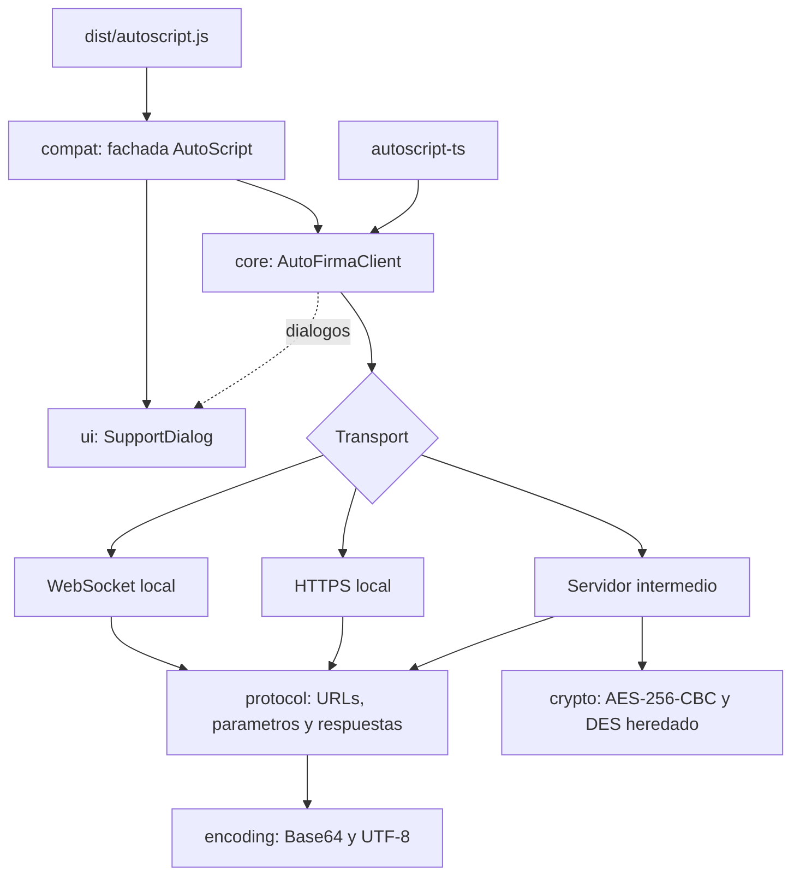

# Arquitectura

AutoScript no firma: es el puente entre la página y Autofirma, que es quien accede a los
certificados y genera las firmas. Esta implementación respeta el protocolo del
`autoscript.js` 1.10.1 original y lo organiza en módulos con responsabilidades separadas.

## Módulos

| Módulo       | Responsabilidad                                                                                                                                                |
| ------------ | -------------------------------------------------------------------------------------------------------------------------------------------------------------- |
| `core`       | `AutoFirmaClient` (una operación activa, configuración congelada por operación, reintentos con diálogo, aborto), `Batch`, catálogo de errores y tipos públicos |
| `protocol`   | Dialecto de cada canal: orden de parámetros, qué valores viajan sin codificar, URLs `afirma://` e `intent://`, XML de subida e interpretación de respuestas    |
| `transports` | Ciclo de vida de cada canal: arranque de Autofirma, búsqueda de puerto, eco, `#wait`, fragmentación, sondeo y certificado fijado                               |
| `crypto`     | AES-256-CBC con WebCrypto y DES-ECB heredado (adaptación tipada del algoritmo del original)                                                                    |
| `encoding`   | Base64 (nativo `Uint8Array.toBase64` si existe) y UTF-8 con `TextEncoder`                                                                                      |
| `browser`    | Entorno inyectable (`fetch`, `WebSocket`, temporizadores, plataforma), comprobación horaria y descargas                                                        |
| `ui`         | Diálogo de soporte con el DOM, las clases y los textos del original, saneado de HTML                                                                           |
| `compat`     | Objeto `AutoScript` con callbacks sobre el cliente moderno, y registro de globals                                                                              |

`core`, `protocol`, `encoding` y `crypto` no usan el DOM: el SDK se puede importar en SSR. Todo
lo que depende del navegador entra por `Environment`, que las pruebas sustituyen.

## Canales

|                   | WebSocket                                               | HTTPS local                                                                      | Servidor intermedio                                                |
| ----------------- | ------------------------------------------------------- | -------------------------------------------------------------------------------- | ------------------------------------------------------------------ |
| Uso               | Escritorio (por defecto)                                | Navegadores sin WebSocket                                                        | Android, iOS y `setForceWSMode(true)`                              |
| Arranque          | `afirma://websocket?ports=…&v=4&jvc=4&idsession=…`      | `afirma://service?…`                                                             | `afirma://operacion?jvc=4&…` o `intent://` en Chrome Android       |
| Comunicación      | `wss://127.0.0.1:puerto`, eco y operación por el socket | `POST https://127.0.0.1:puerto/afirma` con `cmd=`, `fragment=`, `firm=`, `send=` | StorageService (`op=put`) y RetrieveService (`op=get`)             |
| Reutilización     | El socket queda abierto entre operaciones               | El puerto se reutiliza; si deja de responder se relanza                          | Se invoca la aplicación en cada operación                          |
| Cifrado adicional | No                                                      | No                                                                               | AES-256-CBC (WebCrypto) y DES heredado en la primera subida grande |

Al buscar el puerto por WebSocket, los sockets que siguen conectando se conservan entre
intentos (por ejemplo mientras el navegador pide permiso de acceso a la red local) y los
perdedores se cierran al conectar.

## Errores y diálogos

Cada error es un `AutoFirmaError` con `type` (la excepción Java que recibía el callback del
original), `code` (`ASxxxxxx`) y, si procede, el diálogo de ayuda (`connecting-afirma`,
`connecting-service`...). El cliente muestra ese diálogo si tiene `dialogs` configurado y,
si el usuario pulsa «Reintentar operación», repite la operación.

## Pruebas

- `tests/differential/`: ejecutan el `autoscript.js` original y esta implementación en jsdom
  contra el mismo Autofirma simulado (WebSocket, HTTPS local y servidor intermedio con
  cifrado real) y comparan mensajes, subidas descifradas, callbacks y DOM de los diálogos.
- `tests/*.test.ts`: pruebas unitarias del SDK con un entorno simulado.
- `tests/package/`: cargan `dist/` tal como se distribuye (exports, tipos, `autoscript.js` en
  una página con una firma completa y presupuesto de tamaño).
- `bench/`: rendimiento de los codecs frente al original.
